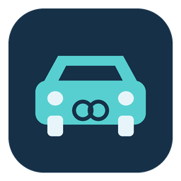

# Carlink for Home Assistant

A custom, cloud-dependent integration exposing **Doors** (lock/unlock),
**Start engine**, and **Stop engine** for the **first vehicle in a Carlink account**.
This is not an official Carlink integration. The original neutral icon is not a
vendor logo (source: `scripts/generate_icon.py`).

## Status and requirements

Development/test build; offline tests use real **Home Assistant 2026.9.3** and
**Python 3.14.7** on macOS. HACS's minimum is **2026.9.3**, the tested baseline,
not a promise of compatibility with all later releases. Linux/HA OS, hosted CI,
HACS download, and live vehicle operation have not yet been verified.
See [compatibility and verification](docs/compatibility.md).

The library is pinned to an approved immutable Git revision, **not a published
PyPI release**. Home Assistant dependency installation needs Git, network access
to GitHub/package indexes, and a compatible Python environment. Installation on
your target instance remains an acceptance gate; do not replace the pin with an
unverified PyPI version.

## License

[MIT License](LICENSE), copyright (c) 2026 angel12.

## Install using HACS (after repository publication)

The repository must contain the reviewed files on GitHub before these steps can
work. This checkout does not itself constitute a published release.

1. Install [HACS](https://www.hacs.xyz/docs/use/) if needed.
2. In HACS, open the menu → **Custom repositories**. Add
   `https://github.com/angel12/ha-carlink`, category **Integration**.
3. Find **Carlink** in HACS and download it. Restart Home Assistant.
4. Open **Settings → Devices & services → Add integration → Carlink**.
5. Enter your **Carlink service email and password**, not your Home Assistant
   login. The password field is masked. HACS only downloads files; it does not
   collect your Carlink credentials. No YAML credentials are needed.
6. The first vehicle becomes a device called **Vehicle**, with Doors, Start
   engine, and Stop engine entities. Rename the device in HA if desired.

Manual fallback: copy only `custom_components/carlink/` into your Home Assistant
configuration's `custom_components/carlink/`, then restart and follow steps 4–6.
Do not copy the repository's tests, virtualenv, or `custom_components/__init__.py`.
Do not mix HACS-managed and manually managed copies.

## Important behavior and safety

- **First vehicle only.** There is no vehicle selector. Account and asset IDs
  are persisted; setup and reauthentication refuse a different identity rather
  than silently redirecting controls if account vehicle order changes. Resolve
  the identity mismatch before using controls; re-adding is not a safe shortcut
  unless you have independently verified the intended first vehicle.
- **Door state stays unknown**, including after successful lock/unlock. The
  client does not provide trustworthy locked/unlocked telemetry for this v1.
  Start/stop are command buttons, not an engine-state switch. A button timestamp
  or command acknowledgement is not measured physical state.
- **Cloud required.** There is no recurring telemetry polling or periodic
  reachability test. Entity availability means the cached client is usable, not
  that the vehicle is online or that the cloud session is still valid.
- **Commands may take time.** The library waits for cloud command results.
  Requests timeouts and polling do not establish a fixed upper wall-clock bound.
  Do not repeatedly press controls while waiting.
- **Overlaps are rejected, not queued.** A busy error means the new action was
  not submitted; it says nothing about the action already running. Cancelling a
  service call does not necessarily stop its worker or a physical action.
- **Unknown outcome means the action may already have happened.** On timeout,
  network error, or an unknown result, verify the vehicle independently. Do not
  retry automatically, create retry automations, or assume the action failed.
  Terminal cloud failure is reported separately; neither result proves the
  present physical state.
- Setup, restart, reload, unload, and reauthentication **never send physical
  commands**. Setup/reauthentication do perform cloud login/identity reads.
  No failed or pending command is replayed after login or reload.
- On authentication failure, use the HA reauthentication prompt to enter the
  Carlink credentials again. Account/vehicle identity must still match.
- Normal successful cleanup permits reload. Reload/unload waits for active work
  to drain, so shutdown may be delayed. On **failed unload**, or **genuinely
  failed teardown after partial setup**, restart Home Assistant after resolving
  the underlying issue. These paths are restart-only recovery; repeated reload
  is not a recovery guarantee. An ordinary setup failure whose cleanup succeeds
  can be retried/reloaded.

## Credentials and privacy

Credentials are stored in Home Assistant's config-entry storage (`.storage`),
not encrypted by this integration. Protect the HA filesystem, access to HA, and
backups containing config entries. Do not post storage files, credentials,
authorization headers, or raw HTTP traces in bug reports. The tests use synthetic
identities and secret sentinels; never replace them with your own login.

## Testing and troubleshooting

See [compatibility.md](docs/compatibility.md) for exact offline commands and
remaining acceptance gates. CI installs dependencies and contacts GitHub for
packaging validators; tests block external sockets and need no Carlink account.

Live testing is a separate, explicitly approved step: first confirm installation
and login without actuating anything, verify the selected vehicle independently,
then, only with approval, test one action at a time in a safe location with the
vehicle in view. Never start an engine in an enclosed space. Record actual
physical outcomes independently; do not use HA's unknown lock state as evidence.
No live login or command was used for development acceptance.

Report the HA/Python versions and sanitized error category at the
[issue tracker](https://github.com/angel12/ha-carlink/issues), without credentials.

## Uninstall

Wait for active work to settle and verify the vehicle independently if an outcome
is unknown. Delete the Carlink entry in **Settings → Devices & services** first,
then remove the integration download in HACS (or remove only the manually copied
`custom_components/carlink/` directory) and restart HA. If unloading failed, use
the restart recovery described above. Uninstalling does not undo physical actions
or remove credentials from existing backups; protect or securely retire those
backups separately.
